# Agent system

Every agent implements

```rust
#[async_trait]
pub trait Agent: Send + Sync {
    type Input: Send;
    type Output: Send;
    fn name(&self) -> &'static str;
    async fn execute(&self, input: Self::Input) -> Result<Self::Output, AgentError>;
}
```

Agents have genuinely different inputs, outputs, prompts and validation; none is a renamed copy of another.

```mermaid
flowchart LR
    Q[user query] --> P[Planner] --> Plan[ResearchPlan]
    Plan --> Task[ResearchTask]
    Task --> R[Researcher] --> F[ResearchFindings<br/>sources + grounded claims]
    F --> V[Verifier] --> Verdicts[support level per claim]
    Verdicts --> C[Contradiction Detector] --> Pairs[classified disagreements]
    Verdicts & Pairs --> S[Synthesizer] --> Rep[ReportContent]
    Rep --> K[Critic] --> Crit[CritiqueDraft]
```



| Agent | Input | Output | Tools | Validation |
|-------|-------|--------|-------|------------|
| Planner | query, max questions | `ResearchPlan` (questions, objectives, priorities, required evidence, dependencies, depth) | LLM | size bound, non-empty text, dependencies only on earlier questions (acyclic) |
| Researcher | one task | `ResearchFindings` (sources + claims) | LLM, `SearchProvider`, `Fetcher` | excerpt must occur verbatim in the source; per-task URL dedup; claims per source capped |
| Verifier | claims + excerpt + surrounding context + source metadata | `Vec<Verdict>` | LLM | returned ids must belong to the batch; missing verdicts become `UNVERIFIED`; confidence capped |
| Contradiction Detector | verified claims grouped by research question | classified claim pairs | LLM | ids must be in the group; pair must span two different sources; `NO_CONFLICT` dropped |
| Synthesizer | verified claims, contradictions, gaps, reviewer feedback | `ReportContent` | LLM | only provided claim ids; key findings must be cited |
| Critic | draft report, claims, contradictions | `CritiqueDraft` (quality, issues, required research) | LLM | score in [0,1]; issue claim ids must exist |

## Researcher steps

1. LLM writes search queries for the task (bounded count, deduplicated).
2. Queries run against the `SearchProvider`; results are deduplicated by normalized URL and ranked so
   government/academic hosts come first (`SourceType::guess_from_host`).
3. Content comes from the search result, otherwise the `Fetcher`.
4. One LLM call per source extracts claims with a verbatim excerpt, and classifies `source_type` and
   `nature` (primary, secondary, commentary, opinion, marketing).
5. Claims whose excerpt is not found in the page are rejected and counted.

The researcher does not write the report and does not touch the database; the orchestrator persists its output
so large content never lives in in-memory state.

## Verifier support levels

`SUPPORTED`, `PARTIALLY_SUPPORTED`, `CONTRADICTED`, `UNSUPPORTED`, `UNVERIFIED`. Only the first two are citable.
Broad claims backed by narrow evidence are `PARTIALLY_SUPPORTED` and the verifier's note on what *is*
supported is passed to the synthesizer as mandatory scope.

## Contradiction kinds

`DIRECT_CONTRADICTION`, `CONTEXT_DIFFERENCE`, `TIME_DIFFERENCE`, `POPULATION_DIFFERENCE`,
`METRIC_DIFFERENCE`, `SCOPE_DIFFERENCE`, `NO_CONFLICT`. Only a direct contradiction is "genuine". Both claims
are always preserved; the system never silently picks a winner.

## Critic and the decision to iterate

The critic's score is one input. `orchestrator::review` applies explicit rules:

* Deterministic checks add issues without asking a model (uncited key finding = high severity; genuine
  contradiction not discussed; key finding resting only on partial support).
* Research questions with **no citable claim** are coverage gaps and trigger follow-up research by themselves.
* Iterate if there are follow-ups (gaps, or critic requested new research) **and** iterations remain.
* Otherwise accept; if a high-severity issue or quality below 0.7 remains, accept *with limitations*: the
  outstanding issues are appended to the report's limitations section.
