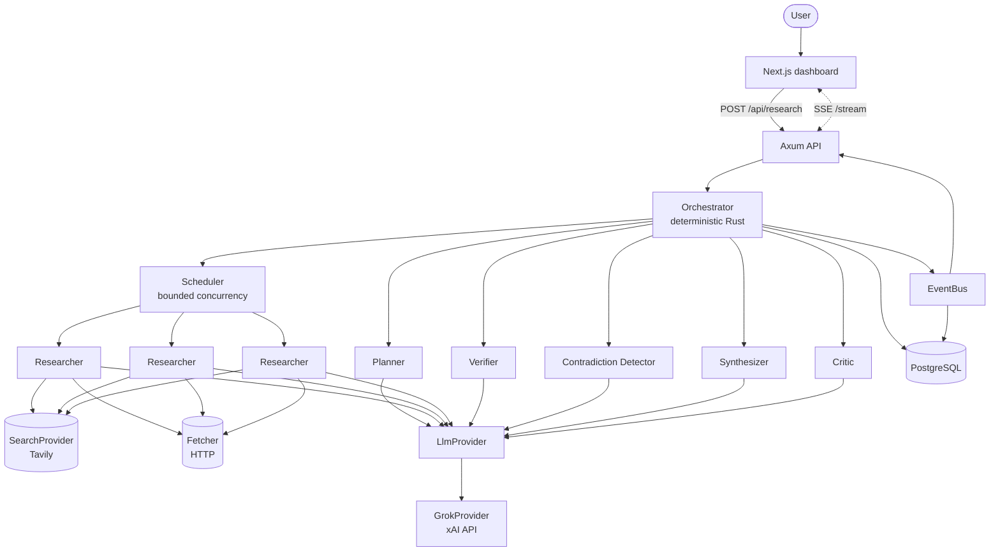

# Architecture

Deep Research OS separates **deterministic orchestration** (Rust) from **probabilistic reasoning** (Grok).

Rust owns state, scheduling, concurrency, retries, timeouts, persistence, iteration limits and events.
Grok only provides reasoning inside individual agents: planning, claim extraction, evidence assessment,
contradiction analysis, synthesis and critique. No model decides what runs next.

## System overview

## Layers

| Layer | Module | Responsibility |
|-------|--------|----------------|
| API | `api/` | HTTP + SSE; reads persisted state, starts runs |
| Orchestrator | `orchestrator/` | state machine, scheduler, review criteria, workflow, event bus |
| Agents | `agents/` | six typed components, each with its own prompt, input and output |
| LLM | `llm/` | `LlmProvider` trait, Grok implementation, structured-output helper, concurrency limiter |
| Tools | `tools/` | `SearchProvider` (Tavily) and `Fetcher` (HTTP + HTML to text) |
| Persistence | `database/` | all SQL, relational schema |
| Models | `models/` | domain types shared by every layer |

Agents never talk to Grok directly: `Agent -> LlmProvider -> GrokProvider -> xAI`. Replacing the model
provider means implementing one trait. The application contains no Claude or Anthropic dependency.

## Principles enforced in code

* **Provenance.** A claim is only stored if its `excerpt` appears verbatim (modulo case/whitespace) in the
  fetched source text (`util::text::excerpt_in_content`). Fabricated quotes are discarded.
* **Model never writes citations.** The synthesizer names claim ids. Rust validates them against the set of
  verified claims and builds `[n]` markers and the bibliography from the claim -> source mapping
  (`models::report::CitationIndex`). URLs in a report always come from stored sources.
* **Conservative verification.** Unknown or missing verdicts become `UNVERIFIED`. Confidence is capped
  deterministically by support level and source nature (`models::claim::adjust_confidence`).
* **Bounded everything.** Iterations, tasks per iteration, concurrent tasks, concurrent LLM calls, concurrent
  runs, sources per task, characters per source, claims per source, per-request and per-task timeouts.
* **Honest outcomes.** Partial task failures are recorded and surfaced as limitations; if the critic is
  unavailable the report says so; unresolved critique at the iteration limit is written into the report.

See also: [agent-system](agent-system.md), [research-lifecycle](research-lifecycle.md),
[database](database.md), [api](api.md), [grok-integration](grok-integration.md),
[architecture-decisions](architecture-decisions.md), [development](development.md).
