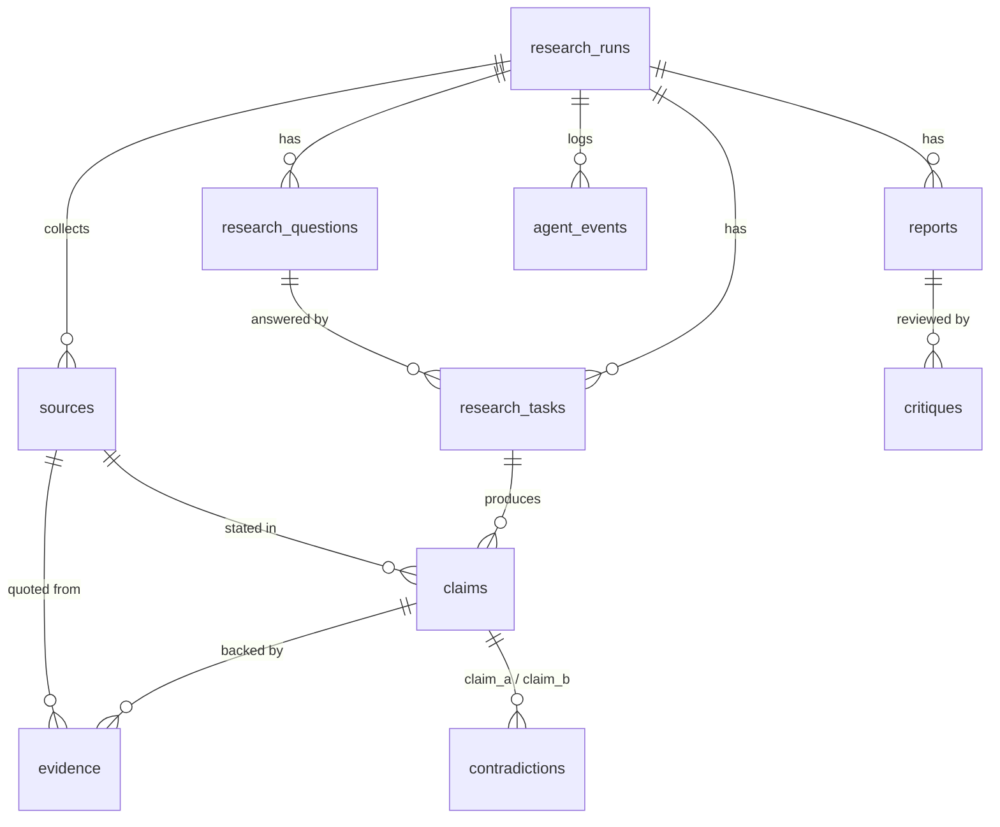

# Database

PostgreSQL via SQLx (runtime-checked queries, so the crate builds without a database). Migrations in
`backend/migrations` are embedded and applied at startup. Relationships are relational; JSON is used only for
flexible lists (`required_evidence`, `dependencies`, report content, issues).

## Traceability

`report -> claim -> evidence -> source -> original url`. A report stores `claim_ids` per statement; citations
are derived from `claims.source_id -> sources.url`. `GET /api/research/{id}/claims` returns each claim with its
evidence excerpt, verifier reasoning and source.

## Deduplication

| Entity | Rule |
|--------|------|
| Source | `UNIQUE (research_run_id, normalized_url)`; the normalizer lowercases the host, drops `www.`, fragments, tracking parameters and trailing slashes. Concurrent tasks finding the same page share one row. `content_hash` is stored for content-level comparison. |
| Claim | `UNIQUE (research_run_id, source_id, dedupe_key)`; key is the whitespace/case-normalized text. |
| Contradiction | `UNIQUE (claim_a_id, claim_b_id)`; the pair is stored in canonical order. |

## Events

`agent_events.id` is a `BIGSERIAL`, giving a total order. SSE clients resume with `Last-Event-ID`.

## Restart behaviour

Runs still in a non-terminal state when the process starts cannot resume; they are marked `failed`
("interrupted by server restart").
