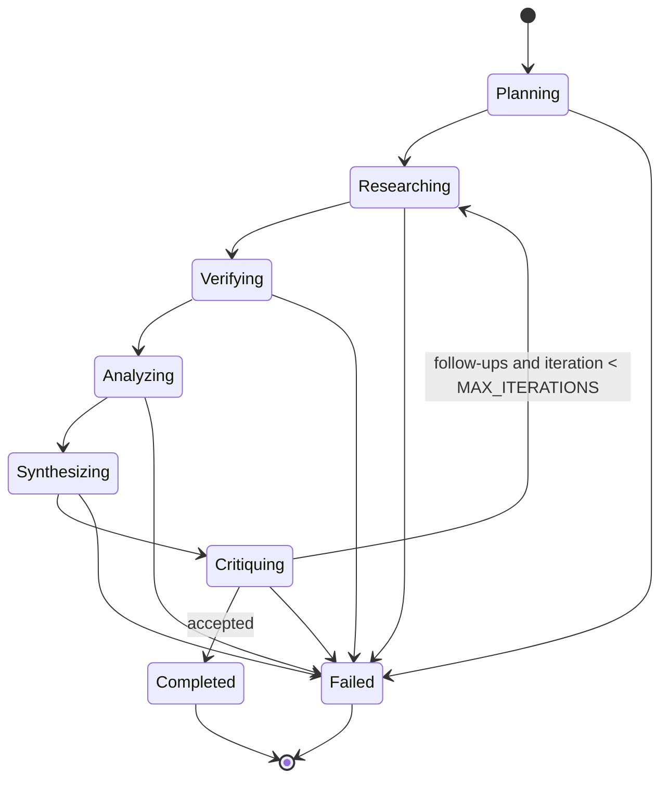
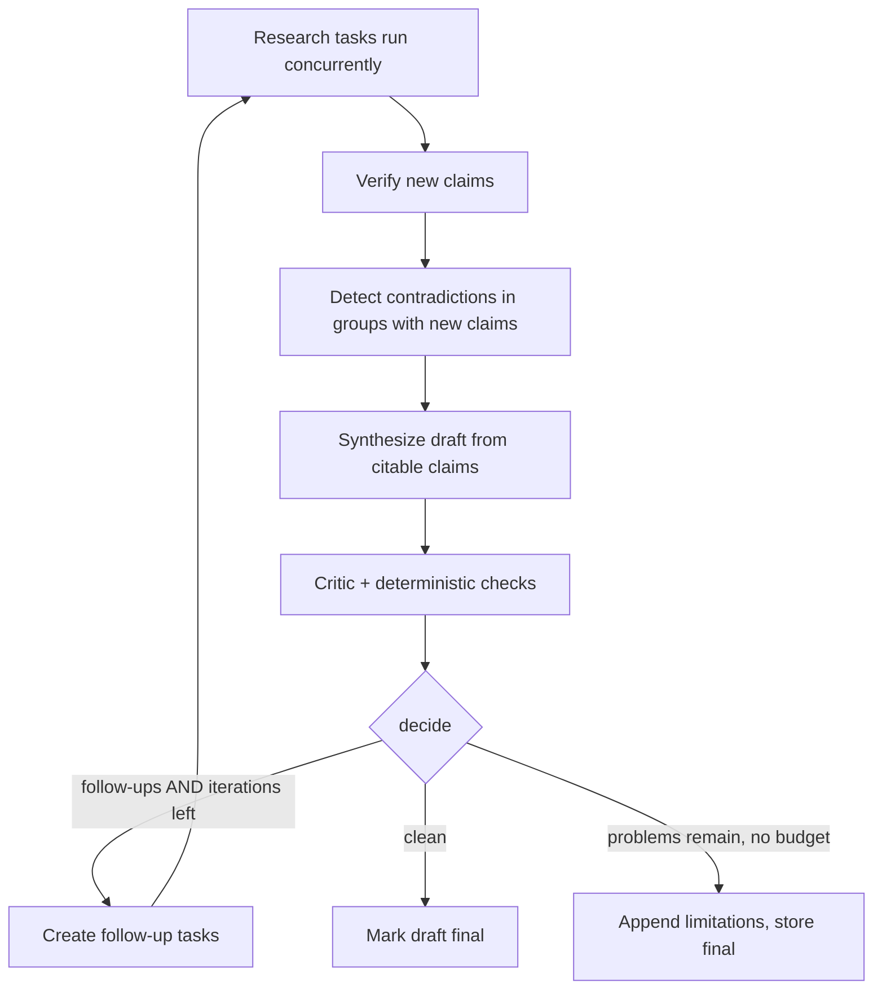

# Research lifecycle

`orchestrator::state::ResearchState` enforces these transitions. The loop-back edge exists only through
`begin_next_iteration()`, which refuses to go past `max_iterations` (default 2).

## Iteration loop

## Phases

1. **Plan.** Planner returns questions; Rust creates one persisted task per question and maps index
   dependencies to task ids.
2. **Research.** `scheduler::run_tasks` runs tasks in dependency waves with `MAX_CONCURRENT_TASKS`, a per-task
   timeout and cancellation. A failed, timed-out or cancelled task never aborts its siblings; dependents of a
   failed task are failed without running. The run fails only if *no* task in an iteration succeeded.
3. **Verify.** New claims (this iteration) are verified in batches. Counts shown in the UI come from the database.
4. **Contradictions.** Citable claims are grouped by research question; only groups that contain a new claim
   are analysed again. Failures here are soft.
5. **Synthesize.** Top claims (strongest first, capped at 60) go to the synthesizer. Rust renders markdown and
   builds citations. If no claim survived verification the run fails with that explanation rather than
   inventing a report.
6. **Critique.** Critic output plus deterministic issues are stored. If the critic fails the report is finished
   with an explicit caveat.
7. **Decide.** See [agent-system](agent-system.md#critic-and-the-decision-to-iterate).

## Events

Every event is persisted (`agent_events`) and then broadcast; the UI renders only these. Types:
`research_started`, `planning_started`, `planning_completed`, `task_created`, `parallel_research_started`,
`task_started`, `search_started`, `search_failed`, `source_found`, `claim_extracted`, `task_completed`,
`task_failed`, `verification_started`, `verification_completed`, `contradiction_analysis_started`,
`contradiction_found`, `contradiction_analysis_completed`, `synthesis_started`, `synthesis_completed`,
`critique_started`, `critique_completed`, `additional_research_required`, `iteration_started`,
`research_completed`, `research_failed`.

## Cost control

Bounded iterations, tasks, concurrency, sources, claims and prompt sizes; URL, claim and contradiction-pair
deduplication; verification only for claims from the current iteration; contradiction analysis only for groups
with new claims; a process-wide cap on in-flight LLM calls shared by all runs.
